<div align="center">

# ✦ TaskFlow

### Plan with purpose · Focus with intention · Make progress measurable

*An intelligent productivity workspace: tasks, calendar, focus timers, reminders, a deterministic deadline-risk planner and approval-based AI agents.*

<br>

[](https://github.com/KK-Dev0/TaskFlow/actions/workflows/ci.yml)


[**Features**](#-features) ·
[**How it works**](#-how-it-works) ·
[**Quick start**](#-quick-start) ·
[**Deploy**](#-deploy-on-render) ·
[**API**](#-api-overview) ·
[**Roadmap**](#-roadmap) ·
[**Limitations**](#-honest-limitations)

<br>

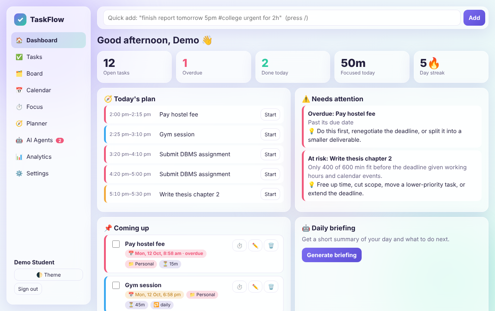

🔗 **Live demo:** [Open TaskFlow](https://taskflow-iv7j.onrender.com)

</div>

---

## 💡 Why TaskFlow?

A normal to-do list stores tasks. It can't tell you whether you'll actually *finish* them. TaskFlow connects **deadlines, estimates, your working hours and your calendar** to answer the questions that matter:

| Question | How TaskFlow answers it |
|---|---|
| *What should I do first?* | Earliest-deadline-first scheduling with priority tie-breaks |
| *Can I finish everything on time?* | A **deadline-risk engine** that shows exactly how many minutes won't fit, and why |
| *How do I start a huge task?* | An AI agent drafts subtasks — **you approve** before anything changes |
| *Where does my time go?* | Focus timers log time against tasks; analytics compare *actual vs estimated* |
| *Will I forget it?* | Reminders with snooze, quiet hours and no duplicate alerts |
| *Can I add tasks quickly?* | Plain-English quick add: `finish report tomorrow 5pm #college urgent for 2h` |

---

## ✨ Features

Everything below is **implemented and covered by tests or a browser smoke test**. Anything not built is listed under [Honest limitations](#-honest-limitations).

### 🗂️ Smart task management
- Tasks with **priority, due date/time, estimate, notes, tags, projects** and **subtasks**
- **Recurring tasks** (daily / weekdays / weekly / monthly) — completing one creates the next, exactly once
- **List view** with search, status/project/priority/due filters and sorting
- **Kanban board** with drag-and-drop between *To do → In progress → Done*
- **Bulk actions** (complete, delete, set priority, move project), **undo delete**, trash with restore
- Keyboard shortcuts: <kbd>/</kbd> quick add · <kbd>n</kbd> new task · <kbd>f</kbd> focus

### 📅 Calendar & reminders
- **Month and week calendar** showing tasks and events, per-day agenda, create/edit/delete events
- **Reminders** before every due date (configurable lead time), custom reminders per task
- **Snooze**, **quiet hours**, browser notifications + sound, **exactly-once delivery** (database-enforced)
- Timezone-aware: everything is stored in UTC and shown in your browser's local time

### ⏱️ Focus & time tracking
- **Pomodoro** (configurable focus / short break / long break / cycles), **stopwatch** and **countdown**
- **Pause / resume**, and **session recovery** after a reload or closed tab
- Time is **logged to the task you pick**; retries are idempotent so nothing is double-counted
- Estimated vs actual time feeds the planner and analytics

### 🧭 Deterministic planner
- Builds a realistic schedule inside your **working hours**, around **calendar events**
- Flags **overdue**, **at-risk** (not enough time before the deadline), **tight** and **calendar-conflict** situations — each with a plain-language reason and a recovery suggestion
- Daily capacity bars show when you're overbooked

### 🤖 AI agents (approval-based)
- **Natural-language quick add** (deterministic parser — works offline)
- **Task decomposition** → subtasks
- **Goal planner** → parent task + subtasks with a due date
- **Priority advisor** → flags tasks whose priority no longer matches their deadline
- **Daily briefing** and **weekly review** with coaching tips
- Works with **no API key** (built-in rules). Add an Anthropic or OpenAI key for model-written output
- Output is **validated on the server**, goes to an **approval queue**, and has a per-user **hourly usage limit**

### 📊 Analytics
- Completion and focus trends (14 days), streak, on-time rate, last-minute rate, estimate accuracy
- Open work by project and priority — descriptive metrics, not guilt-based scores

### 🔐 Accounts & data safety
- Registration/login with **hashed passwords**, per-user **data isolation**
- **CSRF protection**, **login rate limiting**, strict **Content-Security-Policy**, input validation
- **Export / import** a full JSON backup · **delete account** with all data

---

## 🖼️ Screenshots

<table>
  <tr>
    <td width="50%">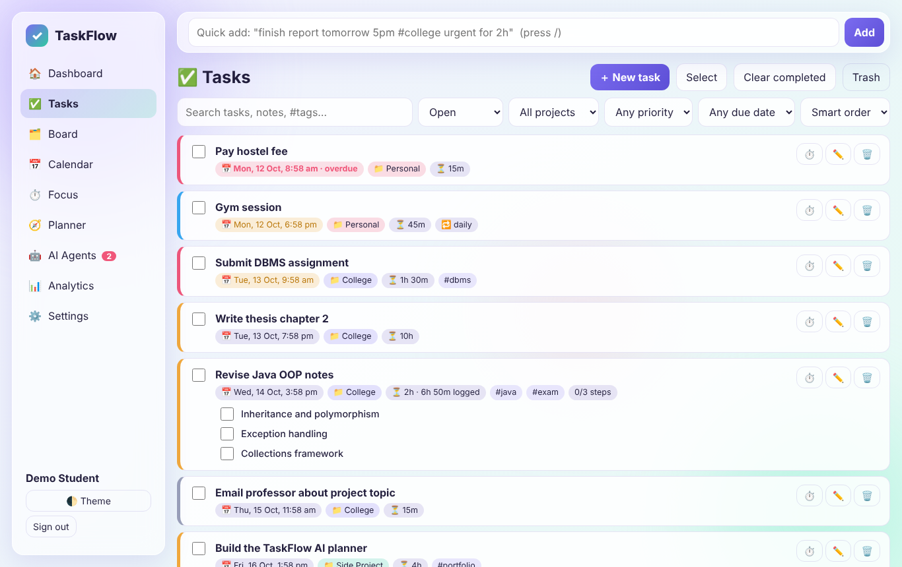<br><sub><b>Tasks</b> — filters, priorities, due chips, subtasks</sub></td>
    <td width="50%">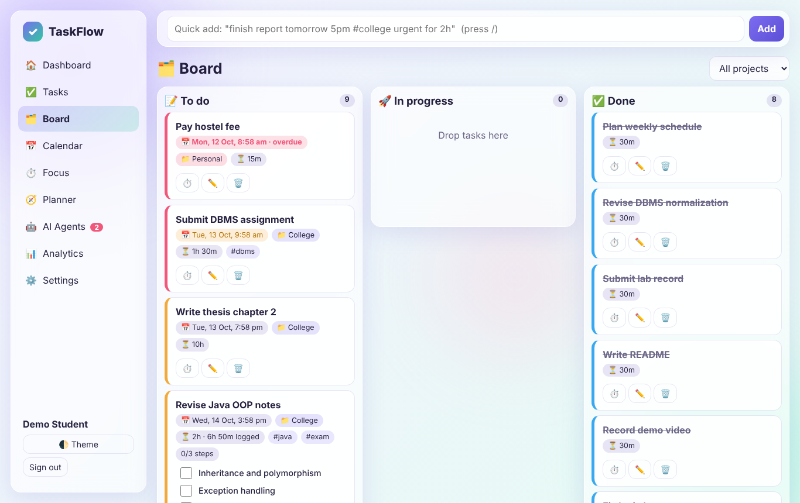<br><sub><b>Board</b> — drag cards between columns</sub></td>
  </tr>
  <tr>
    <td>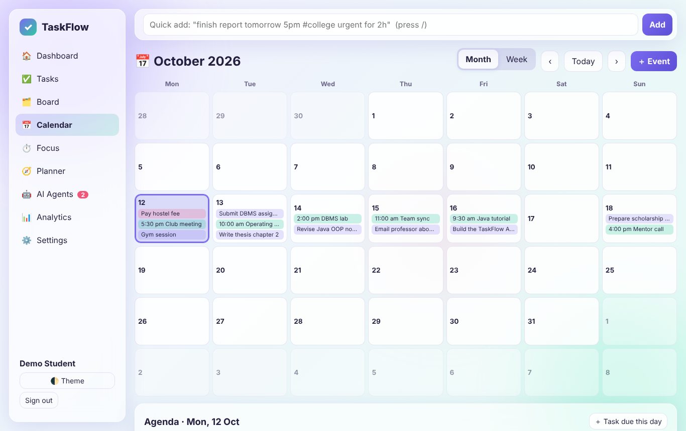<br><sub><b>Calendar</b> — tasks and events, month/week</sub></td>
    <td>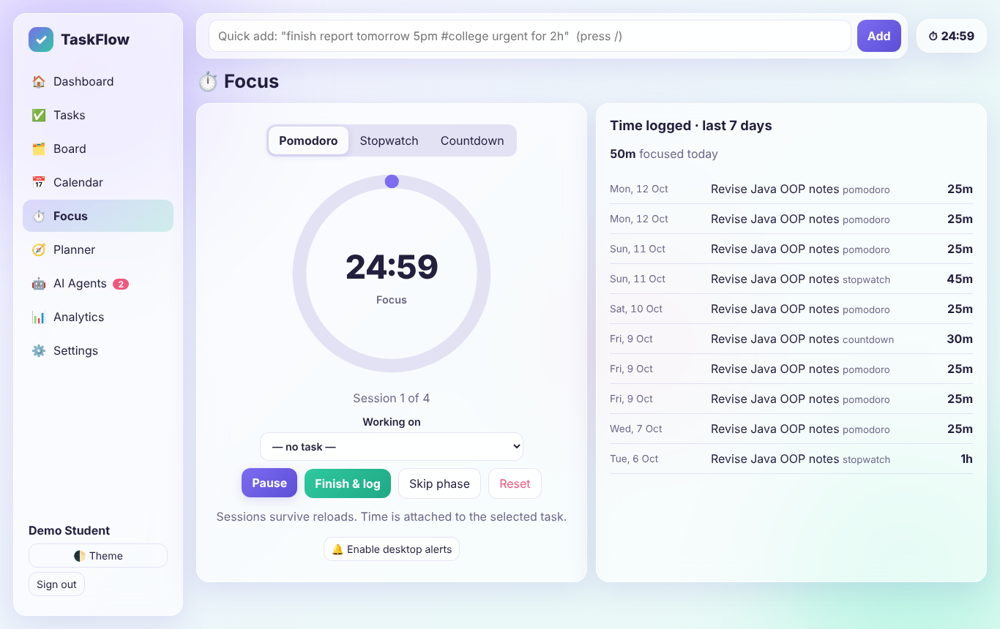<br><sub><b>Focus</b> — Pomodoro, stopwatch, countdown</sub></td>
  </tr>
  <tr>
    <td>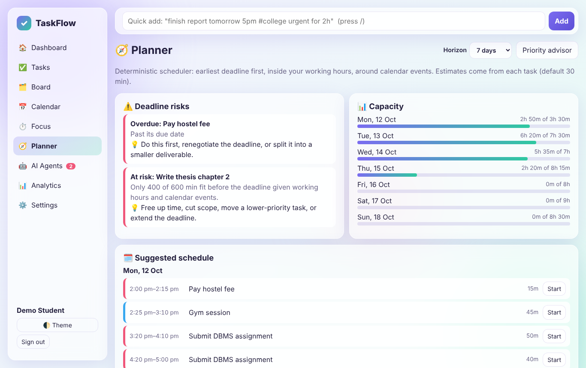<br><sub><b>Planner</b> — deadline risks and capacity</sub></td>
    <td>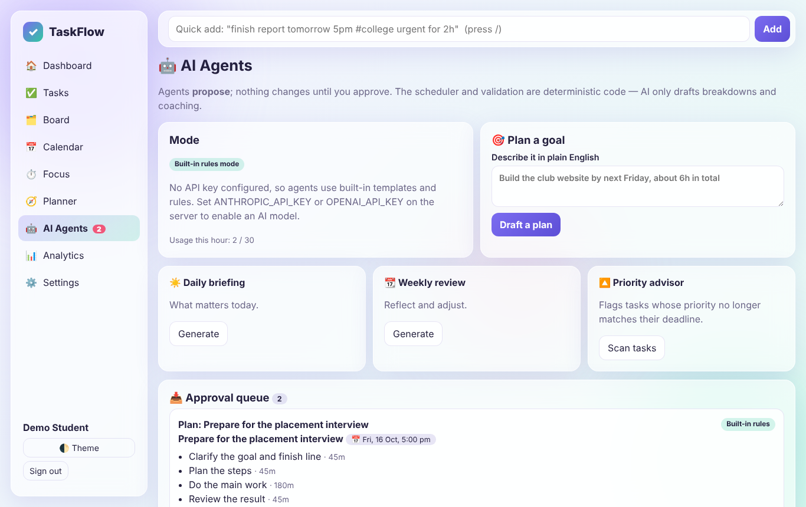<br><sub><b>AI agents</b> — proposals wait for your approval</sub></td>
  </tr>
  <tr>
    <td>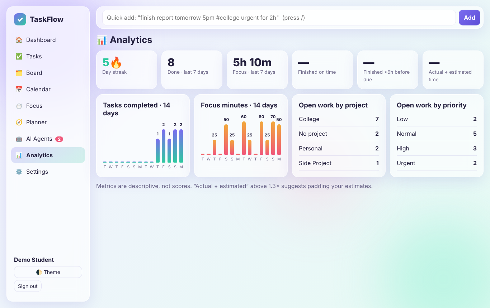<br><sub><b>Analytics</b> — trends and estimate accuracy</sub></td>
    <td>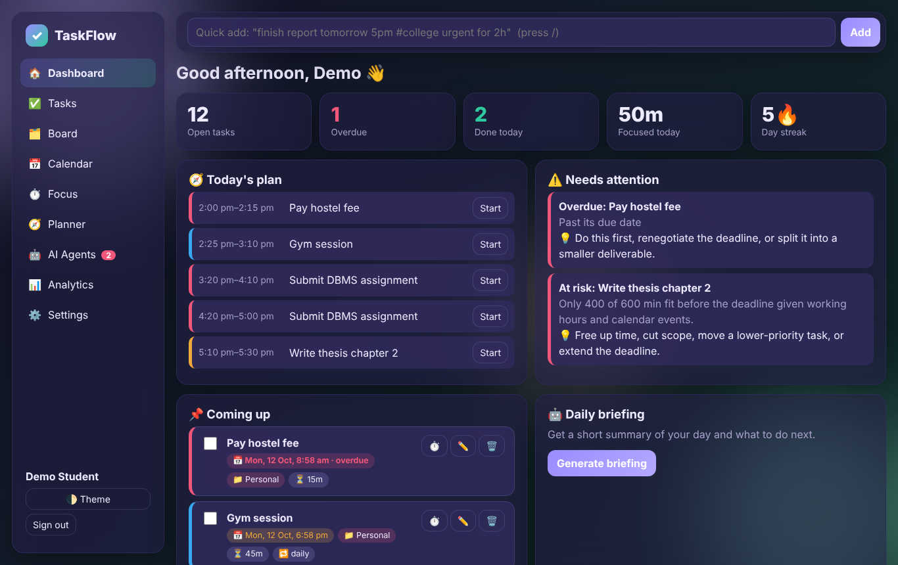<br><sub><b>Dark mode</b> — follows your system, or toggle</sub></td>
  </tr>
</table>

<p align="center">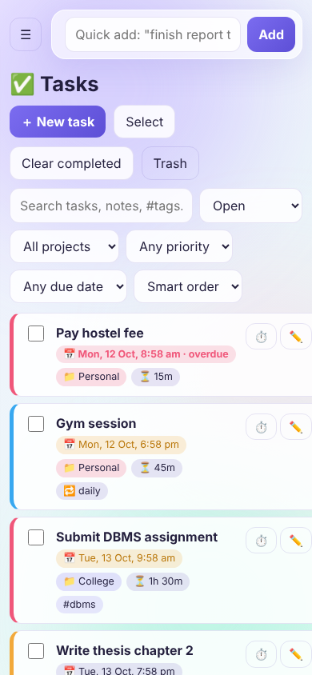<br><sub>Responsive on phones</sub></p>

---

## 🧠 How it works

### AI proposes · you approve · code validates

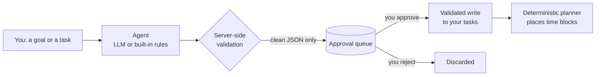

The model never touches your data directly. Its JSON is clamped (max 8 subtasks, title length, estimate and priority ranges), stored as a *proposal*, and applied only when you approve. Approval is idempotent — approving twice can't create duplicates.

### The scheduling algorithm

`planner.py` is pure Python with no database or network access, which makes it fully unit-testable:

1. Build free intervals for each day inside your working hours (today starts at *now*, rounded to 15 min).
2. Subtract fixed calendar events; report overlapping events as conflicts.
3. Sort open work by **earliest deadline**, then **priority**. Overdue work is scheduled first.
4. Place each task into the earliest free time **before its deadline** in focus blocks of ≤ 50 min with 10-min buffers. Time already logged reduces remaining work.
5. Minutes that cannot be placed before the deadline become an **at-risk** finding with a reason and a suggestion. Less than 2 hours of slack is flagged as **tight**.

### Reliability details worth knowing

| Problem | Solution |
|---|---|
| Reminder firing twice | `UNIQUE(task_id, remind_at)` + delivery timestamp set via an idempotent acknowledge |
| Recurring task duplicating | A `tf_spawns` claim row; the next occurrence is created only if the claim insert succeeds |
| Timer log double-counted on retry | Client-generated `client_id` with a unique constraint |
| AI approving twice | Atomic `UPDATE … WHERE status='pending'` claim |
| Half-applied requests | One database transaction per request: commit on success, rollback on error |
| One user reading another's data | Every query is scoped by `user_id`; isolation is covered by tests |

### Architecture

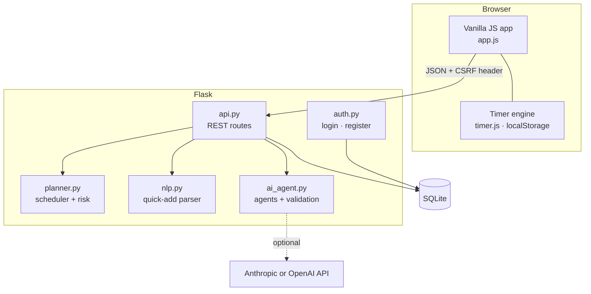

---

## 🚀 Quick start

**Requirements:** Python 3.11+ and Git.

```bash
git clone https://github.com/KK-Dev0/TaskFlow.git
cd TaskFlow

# create and activate a virtual environment
python -m venv .venv
source .venv/bin/activate          # Windows PowerShell: .venv\Scripts\Activate.ps1

pip install -r requirements.txt
python app.py
```

Open **http://127.0.0.1:5000**, create an account, and you're in. The database is created automatically at `instance/taskflow.db`.

### Run the tests

```bash
python -m unittest discover -s tests -v     # or: pip install pytest && pytest
```

37 tests cover authentication, CSRF, data isolation, validation, recurrence, reminders, quiet hours, planner constraints, the quick-add parser, AI approval flow, rate limits, and backup/restore.

### Configuration

All settings are environment variables (see [`.env.example`](.env.example)). The app reads real environment variables; it does not load `.env` files automatically.

| Variable | Default | Purpose |
|---|---|---|
| `SECRET_KEY` | auto-generated file in `instance/` | Signs session cookies. **Set it in production.** |
| `DB_PATH` | `instance/taskflow.db` | SQLite file location |
| `PORT` | `5000` | Dev-server port |
| `COOKIE_SECURE` | on when `RENDER` is set | Set `1` to force `Secure` cookies behind HTTPS |
| `ANTHROPIC_API_KEY` | – | Enables model-written agents (Anthropic) |
| `OPENAI_API_KEY` | – | Enables model-written agents (OpenAI or compatible) |
| `AI_PROVIDER` | auto | Force `anthropic` or `openai` |
| `AI_MODEL` | `claude-sonnet-5-5` / `gpt-4o-mini` | Model name for the chosen provider |
| `OPENAI_BASE_URL` | OpenAI | Point at any OpenAI-compatible endpoint |

> 🔒 Never commit keys or secrets. `.gitignore` already excludes `.env`, databases and `instance/`.

---

## ☁️ Deploy on Render

This repo includes a [`render.yaml`](render.yaml) blueprint and a [`Procfile`](Procfile).

1. Push this repository to GitHub.
2. In Render: **New + → Blueprint** → select the repository → **Apply**.
   *(Or **New + → Web Service** with build `pip install -r requirements.txt` and start `gunicorn app:app --workers 2 --threads 4`.)*
3. Render generates `SECRET_KEY` for you. Optionally add `ANTHROPIC_API_KEY` to enable model-written agents.
4. Open `https://<your-service>.onrender.com/health` — it should return `{"status":"ok"}`.

> ⚠️ **Data persistence:** Render's free instances use an ephemeral filesystem, so a SQLite file is lost on redeploy or restart. For real use, attach a persistent disk on a paid plan and set `DB_PATH=/var/data/taskflow.db` (see comments in `render.yaml`), or host on a platform with a persistent disk. Until then, use **Settings → Export backup** regularly — **Import backup** restores everything.

Step-by-step instructions, including uploading through the GitHub website, are in [**DEPLOY.md**](DEPLOY.md).

---

## 🔌 API overview

All routes are under `/api`, require a signed-in session, and mutating requests need the `X-CSRF-Token` header (the web app handles this). Errors return `{"error": "..."}` with a suitable status code.

| Area | Endpoints |
|---|---|
| Profile | `GET/PATCH /me` · `POST /account/delete` |
| Tasks | `GET/POST /tasks` · `GET/PATCH/DELETE /tasks/<id>` · `POST /tasks/<id>/restore` · `POST /tasks/bulk` · `POST /tasks/clear-completed` |
| Projects | `POST /projects` · `DELETE /projects/<id>` |
| Calendar | `GET/POST /events` · `PATCH/DELETE /events/<id>` |
| Reminders | `POST /tasks/<id>/reminders` · `GET /reminders/due` · `POST /reminders/<id>/ack` · `POST /reminders/<id>/snooze` |
| Time | `GET/POST /timelogs` |
| Planning | `GET /planner?days=7` · `GET /dashboard` · `GET /analytics` |
| AI agents | `POST /ai/parse` · `POST /ai/decompose` · `POST /ai/plan` · `POST /ai/advise` · `GET /ai/review?kind=daily\|weekly` · `GET /ai/status` |
| Approval queue | `GET /proposals` · `POST /proposals/<id>/approve\|reject` |
| Backup | `GET /export` · `POST /import` |
| Health (no auth) | `GET /health` |

---

## 📁 Project structure

```text
TaskFlow/
├── app.py              # Flask app factory, security headers, error handlers
├── api.py              # REST API (tasks, events, reminders, planner, AI, backup)
├── auth.py             # Register / login / logout with CSRF + rate limiting
├── db.py               # SQLite schema and per-request connection
├── planner.py          # Pure-Python scheduler and deadline-risk engine
├── nlp.py              # Plain-English quick-add parser
├── ai_agent.py         # Provider-independent agents + output validation
├── util.py             # UTC/time helpers, recurrence, quiet hours
├── templates/          # app.html, login.html, register.html, error.html
├── static/             # style.css, app.js, timer.js
├── tests/              # 37 unit/integration tests
├── docs/screenshots/   # README images
├── .github/workflows/  # CI (runs the tests on every push)
├── render.yaml         # Render blueprint
├── Procfile            # gunicorn start command
└── requirements.txt    # Flask + gunicorn (standard library does the rest)
```

**Design choices:** standard-library `sqlite3` keeps the dependency list to two packages; route handlers stay thin and business rules live in small, testable modules; the front end is dependency-free vanilla JS served as static files, with no build step.

---

## 🛡️ Security model

| Control | Implementation |
|---|---|
| Passwords | Salted hash via Werkzeug (`generate_password_hash`), never stored in plain text |
| Sessions | Signed, `HttpOnly`, `SameSite=Lax`, `Secure` on Render; session reset on login (no fixation) |
| CSRF | Per-session token required on every form and mutating API call |
| Authorisation | Every query scoped to the signed-in user; foreign IDs return 404 |
| Brute force | Login and sign-up rate limits |
| XSS | All user text escaped in the UI; strict CSP (`script-src 'self'`) |
| Input | Server-side validation of lengths, ranges, dates, colours and enums; parameterised SQL |
| AI | Untrusted model output is sanitised, queued for approval, and rate limited |

---

## 🗺️ Roadmap

**Shipped**
- [x] Accounts, per-user isolation, CSRF, rate limiting, CSP
- [x] Projects, tags, priorities, due dates, estimates, subtasks, recurrence
- [x] List, Kanban and calendar (month/week) views · search, filters, bulk actions, undo
- [x] Pomodoro / stopwatch / countdown with logging and session recovery
- [x] Reminders with snooze, quiet hours and exactly-once delivery
- [x] Deterministic planner with deadline-risk detection and conflict detection
- [x] Approval-based AI agents (decompose, plan, advise, daily/weekly review)
- [x] Analytics, JSON export/import, dark mode, responsive layout
- [x] Automated tests and GitHub Actions CI

**Next**
- [ ] PostgreSQL support and a migration tool (Alembic) for durable cloud hosting
- [ ] Email / web-push reminders that work when the app is closed (needs a background worker)
- [ ] Google Calendar sync
- [ ] Task dependencies and reusable templates
- [ ] Recurring calendar events
- [ ] Password reset by email and email verification
- [ ] Installable PWA with offline support

---

## ⚠️ Honest limitations

TaskFlow is a solid portfolio-grade project, not a finished commercial product. Please know:

- **Reminders only fire while TaskFlow is open in a browser tab** (checked every 30 s, and immediately when you return). There is no email or push when the app is closed — that needs a background worker.
- **SQLite on ephemeral hosting loses data** on redeploy. Use a persistent disk or the export/import backup (see [Deploy](#-deploy-on-render)).
- **Rate limits are in-memory per process**, so they reset on restart and aren't shared between workers.
- **No password reset or email verification** yet.
- **Planner estimates are only as good as your estimates**; unestimated tasks default to 30 minutes. Tasks have no dependencies.
- **Time zone** is taken from your browser each time you open the app, so daylight-saving changes are followed from then on.
- **Not implemented:** Google Calendar integration, task templates, recurring events, installable offline mode.
- AI output quality depends on the model you configure; without an API key the agents use templates and rules.

---

## 🤝 Contributing

Contributions, bug reports and ideas are welcome.

1. Fork the repo and create a feature branch
2. Make a focused change and add or update tests
3. Run `python -m unittest discover -s tests`
4. Open a pull request describing the problem, the fix and how you tested it

For larger changes, please open an issue first to discuss the approach.

## 📜 License

Released under the [MIT License](LICENSE).

---

<div align="center">

**Built by [KK-Dev0](https://github.com/KK-Dev0)** — *little steps, big progress ✦*

</div>
